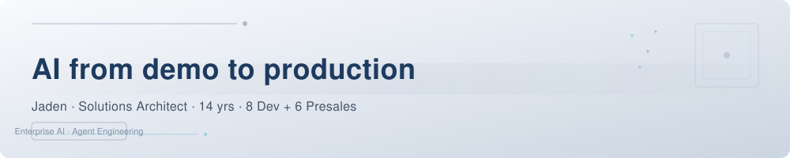

# Hi, I'm Jaden 👋

<p align="center">
  <picture>
    <source media="(prefers-color-scheme: dark)" srcset="https://raw.githubusercontent.com/imjaden/imjaden/main/assets/banner-dark.svg">
    
  </picture>
</p>

📍 **Shanghai** | 🏗️ **Solutions Architect / FDE** | 🚀 **14yrs: 8 Dev + 6 Presales**

ex-Cloudwise, Intfocus.

> ### 🏗️ **"Building the bridge between AI capabilities and enterprise production."**
> 14 years on both sides — I turn LLM demos into systems that run in enterprise production.


## What I Do

> Bring AI from demo to production in enterprise environments.

- 🔓 **Open Source** — Building hands-on AI tools: LLM Radar (auto intelligence dashboard), Agent Loop framework, http-server-cli
- 🧪 **Agent Engineering** — Daily driver of Hermes Agent, Claude Code, Trae, Cursor. Building agent-native workflows and custom agent frameworks.
- 🛠️ **CLI Toolsmith** — 84 system commands for macOS efficiency: alias mgmt, web2md, git workflows, LLM orchestration, document processing
- 🗣️ **Team Enablement** — 13+ morning talks, company lecturer, industry summit speaker
- 🤖 **AI in Production** — Built fault-diagnosis Agent prototypes (MCP + LLM) that went into production validation
- 🏭 **Enterprise AIOps** — Led AIOps platform delivery for China Telecom (31 provinces), China Mobile, UnionPay, Shanghai Hongqiao Airport

## Certifications & Skills


## How I Work

> Agent-native, human-gated. I run my own engineering through an AI agent pipeline — with a human at every checkpoint.

- 🔄 **1A Closed-Loop** — 探讨 → 方案 → review → dev → 核查 → 审计 → 复盘;每步留证据,可回滚
- 🚪 **Review Gate** — push 只由 review role 执行,PASS 才合入,审计留痕
- 📋 **Draft-Driven** — 半自动实施先入 draft(READY);AI 不自我标记完成,用户「已核实」才闭环
- 🤖 **Agent-Native** — Hermes Agent 多 profile(dev/ops/review)协同,串行调度、双机同步
- 🧪 **Data Over Claims** — 每条能力都有可复跑证据:84 CLI / 719 calls / web2md 425 calls

## Projects & Tools

### Past Enterprise Delivery

| Project | Client | Period | Scale |
|:--------|:-------|:------:|:-----:|
| AIOps Smart Ops Platform | China Telecom | 2023–2026/05 | 31 provinces, 1100+ APIs |
| Cloud-Network Unified Ops | China Mobile Research | 2024–2025 | National platform |
| Data Ops Platform | UnionPay (Cloud Flash Pay) | 2020–2022 | 100B+ daily transactions |
| Smart Ops Visualization | Shanghai Hongqiao Airport | 2023–2025 | 257 server rooms, 2000+ devices |

### CLI Ecosystem — `script-miner`

84 system commands under `~/.local/bin/` — my daily drivers:

| Category | Tools |
|:---------|:------|
| 🧠 **LLM** | `hermes-manager` (agent config mgmt), `llmer` (multi-model), `openclaw-manager`, `mcp-manager` |
| 📄 **Doc** | `web2md` (#1 most used, **425 calls**), `feishu-cli`, `evernoter`, `md2word` |
| 🔧 **Dev** | `hermer` (Hermes shortcuts), `git-cloner`, `git-commiter`, `pip-checker` |
| 🏃 **Life** | `diary`, `weekly-miner`, `daily-report`, `train-timetabler` |
| 🖥️ **Mac** | `macosx-manager`, `brew-manager`, `ssl-manager`, `alias-analyze` |

**Usage Heatmap — Top 10 Most Frequent**

| Rank | Alias | Calls | Category |
|:----:|:------|:-----:|:---------|
| 1 | `web2md` | 425 | 📄 Doc |
| 2 | `hermes-manager` | 144 | 🧠 LLM |
| 3 | `favorite-manager` | 42 | 🖥️ Mac |
| 4 | `git-cloner` | 24 | 🔧 Dev |
| 5 | `tool-nav-manager` | 18 | 🔧 Dev |
| 6 | `openclaw-manager` | 15 | 🧠 LLM |
| 7 | `skill-manager` | 15 | 🔧 Dev |
| 8 | `script-manager` | 14 | 🔧 Dev |
| 9 | `git-commiter` | 13 | 🔧 Dev |
| 10 | `secret-manager` | 9 | 🔧 Dev |

> 📊 Total tracked: 719 calls across all tools. `web2md` is the #1 daily driver with 425 calls.

### AI Agent Stack

```yaml
Hermes-Agent:    Primary AI assistant with IRIS persona
Agent-Loop:      Custom agent framework: Think→Act→Observe→Verify
OpenClaw:        LLM orchestration platform
TRAE:            IDE + agent fusion
Cursor:          AI-first editor
Feishu-CLI:      Enterprise comms automation
```

### Personal Sites

- 🌐 **[jaden.tech](https://www.jaden.tech)** — Zero-dependency static site: smart cache, WeChat background generator, automated SSL
- 🔄 **[Agent Loop Lab](https://agent-loop.lab.jaden.tech)** — Think→Act→Observe→Verify agent framework with interactive visualization
- 📡 **[LLM Radar](https://llm-radar.lab.jaden.tech)** — Automated LLM intelligence dashboard (7 sources, 5 dimensions)
- ⚡ **[http-server.cli](https://http-server.cli.jaden.tech)** — Zero-dependency HTTP server manager, `pip install` ready
- 🎨 **[html-gen.cli](https://html-gen.cli.jaden.tech)** — Template-driven static site generator
- 🏛️ **[Cloudwise Archive](https://cloudwise.archived.jaden.tech)** — FDE-targeted solution portfolio
- 🏗️ **[Intfocus Archive](https://intfocus.archived.jaden.tech)** — Full-stack dev journey

## What I'm Doing Now

- 🤖 **Building Agent Loop Lab** — Custom Think→Act→Observe→Verify framework with auto-verifier and checkpoint resume
- 📡 **Running LLM Radar** — Daily 7-source AI intelligence feed with automated MCP data pipeline
- 🛠️ **Growing script-miner** — 84 CLI commands, 719 tracked calls; "if I do it twice, I script it"
- 🎯 **FDE / Solutions Arch** — Solving enterprise product & solution architecture challenges hands-on
- 🏃 **Running** — 5K/10K keeps the long-haul mindset sharp

## Connect

[](https://www.jaden.tech) [](https://github.com/imjaden) [](https://gitee.com/imjaden) [](mailto:jaden.li@jaden.tech) [](https://www.linkedin.com/in/%E4%BF%8A%E6%9D%B0-%E6%9D%8E-132916283/)

---

### Philosophy

> **"Ship beats perfect — but in enterprise, reliability beats speed."**

| 理念 | 实证 |
|:-----|:-----|
| 自动化优先 | script-miner 84 CLI / 719 calls,web2md 425 calls(私有,仅数据) |
| 可靠性优先 | 电信 AIOps:31 省、1100+ API 生产交付 |
| AI-native 工作流 | Hermes Agent 全流程 + 1A 闭环(见 How I Work) |
| 工具即产品 | [http-server.cli](https://http-server.cli.jaden.tech)、[html-gen.cli](https://html-gen.cli.jaden.tech) — 零依赖、pip 可装 |

> I build tools to solve my own problems, then share them. 14 years taught me the best architecture is the one that runs in production.

<details>
<summary>Random Facts</summary>

- 🐶 My Hermes Agent persona is IRIS, a Pomeranian-built AI assistant
- 🎨 Design taste: Cobalt blue + golden yellow (The Truman Show vibes)
- 🏗️ Started as a solo dev, scaled teams to 20+, then moved to presales — seen both sides of the table
- 📝 50+ enterprise environments deployed, 10+ industries covered
- ☕ Powered by Shanghai coffee, fueled by open-source curiosity

</details>
